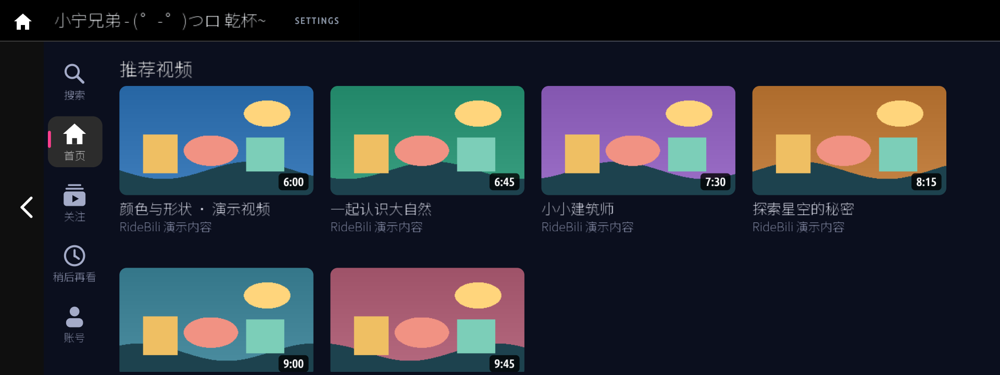
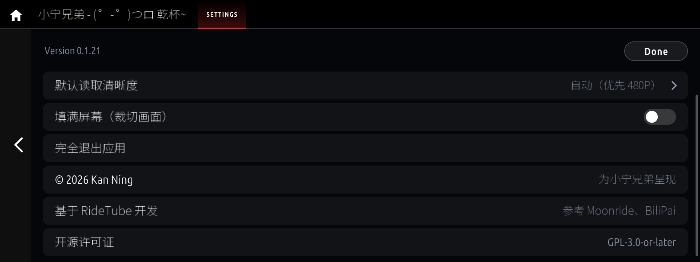
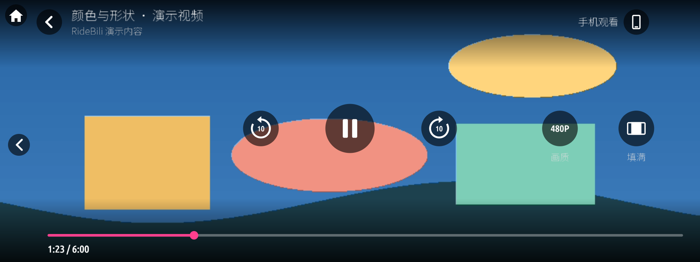

<div align="center">


# RideBili

**为小宁兄弟呈现的 B 站播放器**  
BMW iDrive 7 · MGU · 乘客娱乐与驻车使用

[](https://github.com/SleepyK911/RideBili/releases/latest)
[](LICENSE)
[](#运行环境)

[下载安装](https://github.com/SleepyK911/RideBili/releases/latest) · [功能一览](#功能一览) · [使用说明](#安装与使用) · [致谢](#致谢与许可证)

</div>

---

RideBili 是一个面向 **BMW iDrive 7 / MGU** 的非官方哔哩哔哩客户端，基于 [RideTube](https://github.com/JustAnotherPU/ridetube) 改编。它把 B 站的视频浏览、扫码登录和播放接入车机，围绕手机热点下的起播速度、车机性能和音频稳定性做了适配。

这个项目最初是我为自己的孩子——**小宁兄弟**——制作的小礼物，希望给家人多一种轻松观看视频的方式。图标、首页问候和设置中的署名保留了这份家庭色彩；公开分享的版本也会带着这些个人化元素。

> **请把注意力留给道路。** 本项目面向乘客娱乐和安全驻车场景。驾驶员在行驶中不应观看视频、浏览内容或操作应用；请在安全停车后完成设置与选片，并遵守当地交通规则。孩子观看时，请由监护人选择适龄内容。

## 界面预览

以下画面使用 **0.1.21 的真实应用界面** 在开发环境渲染，配以原创演示封面和模拟视频状态，展示布局与操作入口。它们不是实车照片，也不代表真实 B 站账号或推荐内容。

### 主页



### 设置



### 播放



## 功能一览

| 功能 | 说明 |
| :--- | :--- |
| 浏览与搜索 | 访客首页、关键词搜索，以及 BV 号或普通视频链接 |
| 扫码登录 | 使用 B 站 App 扫码，登录后查看关注与稍后再看 |
| 车机播放 | H.264 硬件解码，优先使用实时 PCM 音频 |
| 清晰度选择 | 默认自动模式优先 480P，可在设置选择 360P / 480P / 720P / 1080P；播放时通过弹窗选档 |
| 热点适配 | 利用 B 站返回的带签名 CDN 地址及备用地址，支持有校验、次数受限的中断接续 |
| 续播与跳转 | 本地续播记录、前后跳转、暂停与恢复 |
| 车机交互 | 触屏与 iDrive 旋钮操作；主页键连续按两次才刷新 |
| 设置与退出 | 原生设置入口；完全退出前停止播放、释放应用取得的音频资源 |
| 备用音频 | 可手动选择兼容 MP3 模式，供实时音频不可用时尝试 |

清晰度受视频、账号权限、B 站接口和网络条件影响，选择 1080P 不保证每条视频都返回该档。实时音频是推荐通路，MP3 转换可能增加等待时间。

当前支持普通 BV 点播的 H.264/AAC DASH 流及公开单文件 MP4 备用流。多 P 视频可通过带 `?p=N` 的网页链接选择分 P。**暂未实现**弹幕、直播、番剧专用播放接口、云端观看进度同步或离线下载。

## 运行环境

- 已具备 MGU Store 安装环境的 **BMW iDrive 7 / MGU** 车机；不适用于普通 Android 车机。
- 可用的 Renderer、Controller gate、Node.js 22 和 Python 运行时，具体最低依赖由安装目录声明。
- 可访问 B 站的网络，例如手机热点。

**0.1.21 已由项目作者完成实车验证。** 开发环境另覆盖了断线重连、重复进出应用、设置和退出、MP3 恢复保护，以及官方 Renderer 0.6.25 的图片和 I420 视频回放。不同车型、固件、运营商和依赖组合仍可能存在差异；目前没有 iDrive 8 的实机验证。

## 安装与使用

### 直接添加软件源（推荐）

在 **MGU Store → Sources / 来源 → Add / 添加 → GitHub** 中输入：

```text
SleepyK911/RideBili
```

也可粘贴仓库链接：[https://github.com/SleepyK911/RideBili](https://github.com/SleepyK911/RideBili)。通道请选择 **Releases / 发布**。刷新后会列出 **RideBili** 和 **RideBili 播放服务**；安装 RideBili 时，Store 会先处理声明的依赖。

本源使用带大小及 SHA-256 校验的预编译包。Node.js 22 沿用上游发布的原包，并列为可自动补齐的依赖；满足版本要求的现有运行时会保留。Renderer、Python、部署工具和 Controller gate 仍由对应的官方来源提供。

### Windows 离线仓库管理器

在 **BMW MGU 离线仓库管理器 1.1.0 / 1.2.0** 中点击「添加 GitHub 来源」，粘贴上述仓库链接。自动识别结果应为 **发布目录（catalog）**；手动选择时也选该通道。随后可检查版本、生成部署 ZIP，并使用管理器原有的部署记录及增量更新功能。

车机联网时使用 Releases，Windows 管理器使用发布目录；二者读取同一个目录。`main` 分支和稳定标签用于查看源码。

固定发布目录地址（也可供支持 HTTPS 目录的工具使用）：

```text
https://github.com/SleepyK911/RideBili/releases/download/catalog/catalog.json
```

### 手动 USB 安装

1. 在 [Releases](https://github.com/SleepyK911/RideBili/releases/latest) 下载 `RideBili-0.1.21-MGU-USB.zip`。
2. 在 Windows 或 Mac 上解压，把 **`USB` 文件夹内的 `mgu-repo`** 复制到 U 盘根目录。
3. 在车机 MGU Store 从 USB 安装或更新。确认 **RideBili 和 RideBili 播放服务都为 0.1.21**，按 Store 提示重新启动。
4. 打开应用，可直接浏览访客内容；需要关注与稍后再看时，在账号入口用 B 站 App 扫码登录。

已有账号和设置在正常更新时保留。新版本依赖已安装时，安装计划会保留满足要求的版本。安装包内含详细说明；需要回退时，可在 Store 对应用和播放服务分别使用「撤销更新」，前提是 Store 仍保留上一版本。

**与原版 RideTube 的关系：** 两者的旧播放服务共用部分车机音视频资源。若同时安装原版服务，RideBili 会在播放前提示冲突，请通过 MGU Store 处理服务冲突后再播放。

## 账户与隐私

扫码登录凭据保存在车机本地，运行时直接请求 B 站接口；本项目不提供代登录服务器。请勿在 Issue、截图或公开日志中上传 Cookie、扫码登录码或个人账号信息。

这是非官方个人项目，与 BMW 或哔哩哔哩不存在官方关联。视频内容和服务由对应平台提供，使用者应尊重内容作者及平台规则。本应用也不是儿童内容筛选或家长控制工具。

## 开发与反馈

源码构建、播放链路和兼容性记录见 [开发说明](docs/DEVELOPMENT.md)，版本记录见 [RideBili 更新说明](docs/CHANGELOG.md)。上游原始更新记录保留在根目录的 `CHANGELOG.md`。

反馈问题时，请说明 RideBili 应用与播放服务版本、Renderer 和 Controller gate 版本、网络类型、出错步骤及完整错误文字。视频问题如方便，可附公开 BV 号；请先移除账户信息。

## 致谢与许可证

**© 2026 Kan Ning · 为小宁兄弟呈现。**

这一署名对应 RideBili 的新增改动，原项目与第三方作者的版权继续保留。感谢以下项目及其贡献者：

| 项目 | 用途 |
| :--- | :--- |
| [RideTube · JustAnotherPU](https://github.com/JustAnotherPU/ridetube) | 应用、车机服务与视频解码器基础，GPL-3.0-or-later |
| [idrive7-apps · cauliflowermossgrape](https://github.com/cauliflowermossgrape/idrive7-apps) | 车机应用工具包与渲染框架，MIT；保留中文翻译贡献者署名 |
| [MGU Store · robertnisipeanu](https://github.com/robertnisipeanu/mgu-store) | 安装平台、组件依赖与 USB 打包格式 |
| [Moonride](https://github.com/JustAnotherPU/moonride) | 实时 PCM 音频输出和 AudioManager 路由参考 |
| [BiliPai](https://github.com/jay3-yy/BiliPai) | B 站扫码登录、WBI 签名与播放接口参考 |
| [FFmpeg](https://ffmpeg.org/) / [LAME](https://lame.sourceforge.io/) | 音频解码及兼容 MP3 工具 |
| [Noto Sans SC](https://github.com/google/fonts/tree/main/ofl/notosanssc) / Ubuntu fonts | 中文及界面字形 |

整体按 **[GPL-3.0-or-later](LICENSE)** 发布，第三方条款见 [THIRD_PARTY_LICENSES](THIRD_PARTY_LICENSES)、[kit/LICENSE](kit/LICENSE) 和 [音频工具声明](native/ride-bili-d/AUDIO-LICENSE)。发布页的完整源码包另附音频工具对应的 FFmpeg / LAME 源码归档及构建脚本。仓库与安装包不包含 BMW OAP SDK。

<details>
<summary>English overview</summary>

RideBili is an unofficial Bilibili client for BMW iDrive 7 / MGU, adapted from RideTube. It supports QR sign-in, browsing, search, H.264 hardware decoding, real-time PCM audio, selectable quality and local resume history. Originally made by Kan Ning for his children, it retains family-specific artwork and wording. Intended for passengers and safe parked use: drivers must remain focused on the road. Development screenshots use original demo artwork and simulated content, not a real account. GPL-3.0-or-later; upstream and third-party notices are preserved.

</details>
